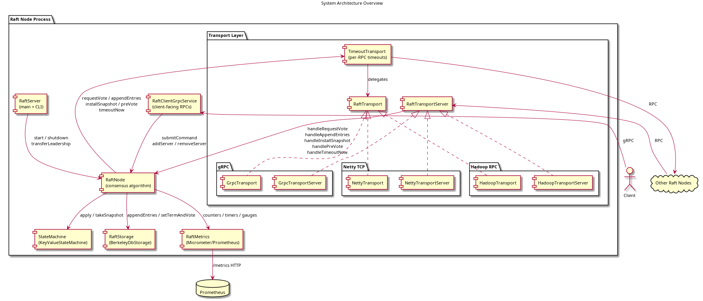
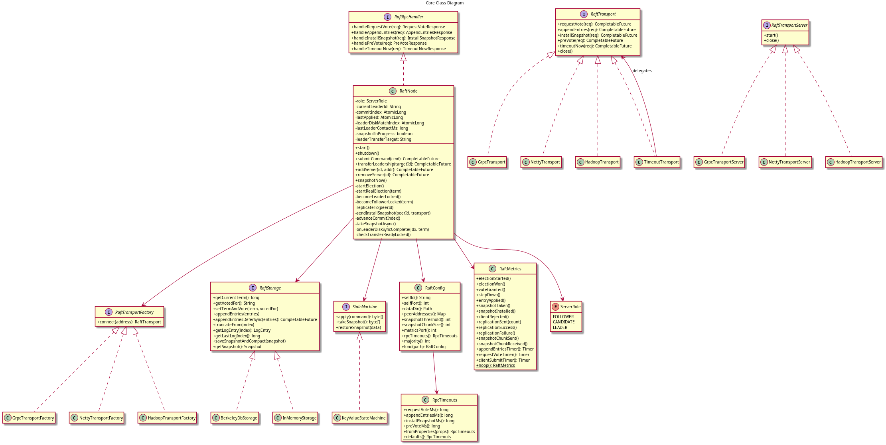
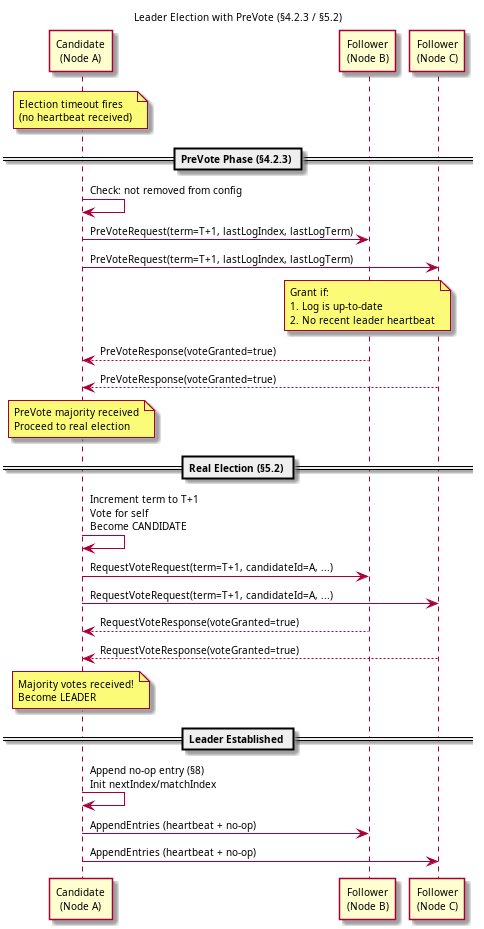
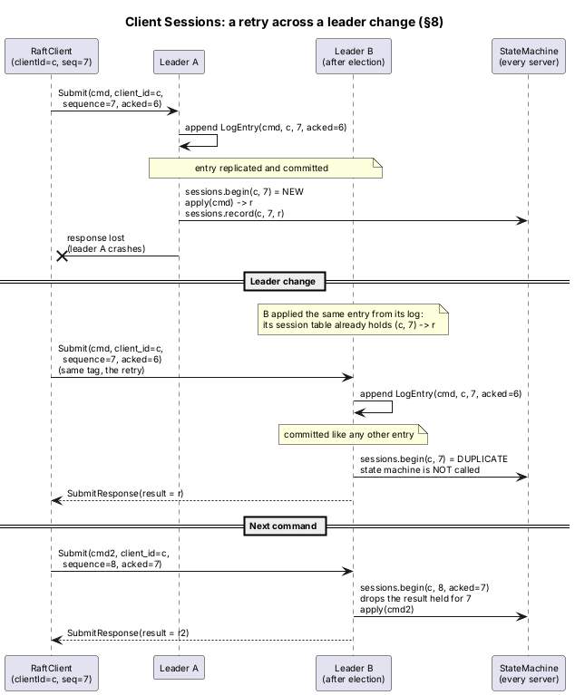
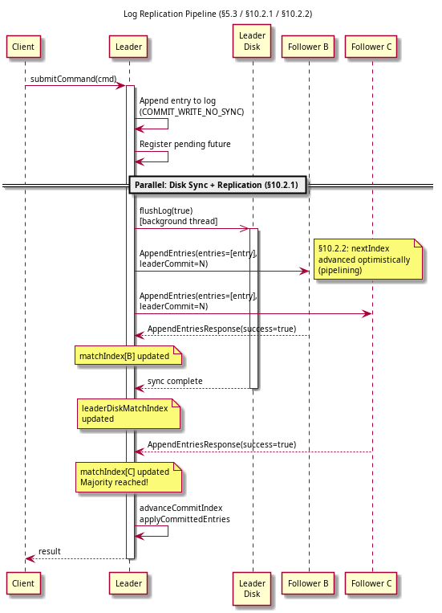
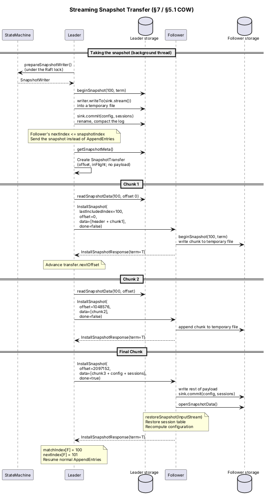
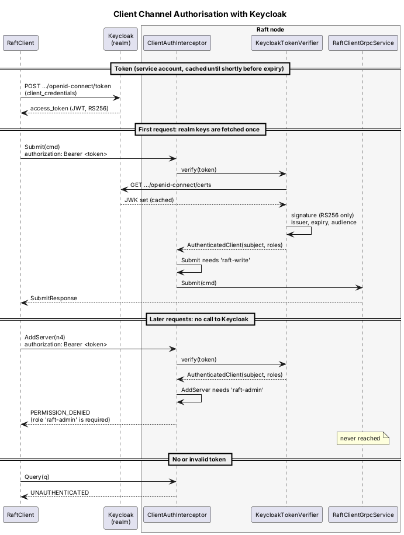

# 1. Overview

**fbtberger-raft** is a from-scratch Java 17 implementation of the Raft consensus algorithm,
following Ongaro & Ousterhout's *"In Search of an Understandable Consensus Algorithm"*
and the PhD dissertation *"Consensus: Bridging Theory and Practice"*.

The project implements:

- **Core Raft** (§5): leader election, log replication, safety rules
- **Leadership transfer** (§3.10): graceful handoff via TimeoutNow RPC
- **Cluster reconfiguration** (§6): single-step changes (`addServer`/`removeServer`) and joint consensus (`setConfiguration`) for arbitrary multi-server changes (with §4 errata fix)
- **Log compaction** (§7): independent snapshotting with chunked InstallSnapshot
- **Client interaction** (§8): no-op entry, leader redirection
- **Linearizable reads**: ReadIndex protocol (`readIndex()`) and lease-based reads (`leaseRead()`) for zero-round-trip reads under stable leadership
- **PreVote + Leader Stickiness** (§4.2.3 / §9.6): prevents partitioned servers from disrupting the cluster; `hasLeaderStickiness()` denies votes when a valid leader is active
- **Performance optimizations** (§10.2): parallel leader disk writes, batching, pipelining
- **Copy-on-write snapshotting** (§5.1): `prepareCowSnapshot()` captures state under the lock; serialization runs on a background thread
- **Transport abstraction**: pluggable gRPC, Netty TCP, and Hadoop RPC with per-RPC timeouts and TLS/mTLS
- **Storage**: BerkeleyDB JE, append-only WAL, or in-memory (pluggable via `RaftStorage`)
- **Observability**: SLF4J/Logback logging, Micrometer metrics (Prometheus + JMX), health checks, JMX MBean

\newpage

# 2. System Architecture

{width=100%}

Each Raft node runs as a single JVM process. The **RaftNode** class owns the
consensus algorithm. It delegates durable storage to **RaftStorage** (backed by
Berkeley DB JE, a segmented WAL, or in-memory for tests), state machine
operations to **StateMachine**, and peer communication to the **Transport**
abstraction layer.

The transport layer is pluggable: **gRPC** (default, HTTP/2 + protobuf),
**Netty** (raw TCP with custom framing), or **Hadoop RPC** (WritableRpcEngine
with BytesWritable-wrapped protobuf). A **TimeoutTransport** decorator applies
per-RPC configurable timeouts to any transport implementation.

Logging uses SLF4J with Logback. Prometheus metrics are exposed via Micrometer
counters, timers, and gauges on a configurable HTTP endpoint.

\newpage

# 3. Class Diagram

{width=100%}

Key design principles:

- **RaftNode** implements `RaftRpcHandler`, making it transport-agnostic
- All dependencies are injected (Spring IoC in production, manual wiring in tests)
- `RaftStorage` separates durable state from the algorithm
- `RaftTransport` / `RaftTransportFactory` abstract the network layer
- `TimeoutTransport` decorates any transport with per-RPC timeouts
- `RaftMetrics` instruments all significant state transitions

\newpage

# 4. Leader Election with PreVote

{width=85%}

The election process has two phases:

1. **PreVote (§4.2.3)**: The candidate checks with a majority that they would
   grant a vote AND haven't heard from a valid leader recently. This prevents
   a partitioned server from incrementing its term and disrupting the cluster
   when it rejoins. The term is *not* incremented during PreVote.

2. **Real Election (§5.2)**: Only after PreVote succeeds does the candidate
   increment its term, vote for itself, and send `RequestVote` RPCs. On
   receiving a majority, it becomes leader and immediately appends a no-op
   entry (§8).

Single-node clusters skip PreVote and elect immediately.

**Leader stickiness on both vote RPCs (v122/v125).** A server refuses to grant a (Pre)Vote while
it has heard from a leader within the minimum election timeout. A leader counts as having heard
from a leader -- itself; without that, the one node whose refusal matters most was the only one
always granting (v122). For `RequestVote` the refusal must come *before* the term is adopted
(§4.2.3): denying the vote but taking the higher term still deposes the incumbent, which is the
disruption the rule exists to prevent. Leadership transfer is the deliberate exception -- a
`TimeoutNow` target marks its `RequestVote`s with `leadershipTransfer`, and voters skip the check
for those, since there the incumbent itself asked for the handover.

**Election epoch (v119).** The election timer is cancelled from several places
(a reset on leader contact, a step-down, winning an election), but
`ScheduledFuture.cancel(false)` cannot stop a task that has already begun --
and a scheduled election task blocked on the node lock has begun. Every such
cancel is therefore best-effort. `RaftNode` carries an `electionEpoch` that is
incremented whenever a pending election becomes invalid; each scheduled task
captures the epoch it was scheduled under and aborts if it no longer matches.
`startElection` additionally refuses to run at all while the node is leader,
and `startRealElection` refuses any term not strictly greater than the current
one -- which is also what makes a decided PreVote round idempotent against a
late second grant.

**Quorum latch (issue #3).** Idempotence-by-consequence is not the rule the code means, so the
PreVote round now also carries its own latch: the first grant to cross the quorum threshold
`compareAndSet`s the round to decided, and every later grant of that round returns. The term
comparisons above still hold; the latch is what states the rule, and it keeps holding if a
future caller ever reaches quorum without moving the term.

**Boot grace (issue #2, requester side).** The first election timer after `start()` is scaled by
`RaftNode.BOOT_DELAY_FACTOR` (6), because a restarting node has to outwait the
incumbent's transport reconnecting to it -- measured at 498-802 ms, against an ordinary timeout
of 150-300 ms -- not merely the heartbeat interval. Only that first timer is scaled: anything
that resets the timer, which any heartbeat does, puts the node back on the ordinary schedule, so
a real failover is not slowed down.

**All three are unconditional.** They were runtime switches (`ElectionSwitches`) until
2026-11-16, defaulting to the fixed behaviour, so the talks could demonstrate the failures
rather than assert them. The switches are gone; `ElectionFixesTest` pins each guard in its
fixed direction.

# 5. Leadership Transfer (§3.10)

A leader can gracefully hand off to a specific target server:

1. **Stop accepting client requests** -- `submitCommand` returns
   `NotLeaderException` with the target as leader hint.
2. **Catch up the target** -- normal heartbeat replication continues until
   `matchIndex[target] >= lastLogIndex`.
3. **Send TimeoutNow** -- the target immediately starts a real election
   (skipping PreVote and election timeout), wins, and the prior leader
   steps down on seeing the higher term.
4. **Abort on timeout** -- if transfer doesn't complete within
   `ELECTION_TIMEOUT_MAX_MS`, the leader aborts and resumes normal operation.

```java
node.transferLeadership("n2").get(1, SECONDS);
```

# 5.1 Linearizable Reads (ReadIndex + Lease)

A local read from the state machine is not linearizable because the node may be
a stale leader (split-brain). Two mechanisms are provided:

**ReadIndex** (`readIndex()`): confirms leadership before allowing reads.

1. **Record** `readIndex = commitIndex` at the time of the call.
2. **Confirm leadership** by sending a heartbeat round to all peers and waiting
   for a majority to acknowledge (via successful `AppendEntries` responses).
3. **Wait** for `lastApplied >= readIndex` so the state machine is up to date.
4. **Complete** the future -- the caller can now read safely.

```java
node.readIndex().thenRun(() -> {
    String value = stateMachine.get("key"); // linearizable
});
```

**Lease-based reads** (`leaseRead()`): serves reads immediately (no heartbeat
round-trip) when the leader holds a valid lease -- i.e., a majority of peers have
acknowledged a heartbeat within the election timeout window. If the lease has
expired, falls back to `readIndex()` transparently.

```java
node.leaseRead().thenRun(() -> {
    String value = stateMachine.get("key"); // linearizable, zero RTT if lease valid
});
```

Lease reads assume bounded clock skew. Use `readIndex()` if clocks may diverge
significantly. Single-node clusters complete immediately for both methods.

# 5.2 Joint Consensus (§6)

In addition to single-step changes (`addServer`/`removeServer`), the system
supports arbitrary multi-server membership changes via joint consensus:

1. **Phase 1 (C\_old,new)**: The leader proposes a configuration entry containing
   both old and new member lists. During this phase, `advanceCommitIndex()`
   requires separate majorities from both old and new configurations via
   `hasSeparateMajorities()`.
2. **Phase 2 (C\_new)**: When C\_old,new commits, the leader automatically proposes
   C\_new (the final configuration with only the new members). Old-configuration
   nodes not in C\_new step down once this entry commits.

```java
node.setConfiguration(Map.of(
    "n1", "host1:9091",
    "n2", "host2:9092",
    "n5", "host5:9095"  // replaces n3
)).get(5, SECONDS);
```

\newpage

# 5.3 Non-voting Learners (§4.2.1)

A **learner** is a server the leader replicates the log to, but which is
excluded from every majority decision: it is never solicited for (Pre)Votes,
never counted toward the commit quorum, never counts toward a ReadIndex
leadership confirmation or the leader lease, and is never part of
`majority()`. Learners live in the `learners` field of `ClusterConfiguration`
alongside `members` and `old_members`, are carried through both joint-consensus
phases, and are persisted inside snapshots, so the learner set survives
reconfiguration and log compaction exactly like the voting membership.

The purpose is to add a server without an availability gap: a new node joins as
a learner, catches up its log via the ordinary `AppendEntries` / `InstallSnapshot`
path while the cluster keeps its original majority, and is only then promoted to
a voting member. `promoteLearner()` refuses until the learner's `matchIndex` has
reached the leader's commit index, so the enlarged majority never includes a
server that is still missing committed entries.

A node started with `node.learner=true` bootstraps as a learner: it lists the
existing voters as peers but keeps itself out of the voting configuration, so it
never stands for election on its own until a committed configuration entry
promotes it.

```java
node.addLearner("n4", "host4:9094").get(5, SECONDS);  // leader only; starts catch-up
// ... n4 catches up ...
node.promoteLearner("n4").get(5, SECONDS);            // once matchIndex >= commitIndex
node.removeLearner("n4").get(5, SECONDS);             // or drop it without promoting
```

\newpage

# 5.4 Client Sessions: Exactly-Once Commands (§8)

{width=85%}

Raft by itself gives a client *at-least-once*: a leader can commit a command and
fail before it answers, the client retries against the next leader, and the
command is in the log twice. A session closes that gap.

**The tag.** A client picks a random `client_id` once and numbers its commands
from 1. `SubmitRequest` carries `client_id`, `sequence` and `acked_sequence`; the
leader copies all three into the `LogEntry`. A retry repeats the same pair, on
whichever node it reaches.

**The table.** `ClientSessions` maps each client to the results of the sequences
it has not acknowledged yet. `RaftNode.applyCommittedEntries()` consults it for
every tagged entry, in log order, on every server:

| Verdict | Condition | Effect |
|---------|-----------|--------|
| `NEW` | sequence not recorded | state machine applies; result recorded |
| `DUPLICATE` | sequence recorded | state machine **not** called; recorded result returned |
| `STALE` | sequence at or below `acked_sequence` | not applied; fails with `StaleClientRequestException` |

A duplicate is still appended and committed. Whether a command is a duplicate
is only certain at apply time, once everything before it has been applied; a
leader that refused it earlier from its current view would miss a copy still in
flight in the log.

**Replicated, not cached.** The table changes only while applying committed
entries, so all servers hold the same table at the same index. It is stored in
every snapshot (`RaftStorage.Snapshot.sessionData`) and replaced whenever a
snapshot is restored or installed, which is what keeps a retry recognised after
the entry that carried the tag has been compacted away.

**Bounded.** A result is dropped as soon as a later command from the same client
acknowledges it. A client that never returns is evicted once
`ClientSessions.MAX_SESSIONS` (4096) other clients have been active, least
recently used first. The bound is a constant and not a setting: eviction decides
whether a command is applied, so it must be identical on every server.

**Limits, stated.**

- A client whose retry is still in flight while 4096 other clients commit loses
  the protection for that one retry.
- A command submitted without a `client_id` is applied on every arrival, as before.
- Do not send session tags to a cluster that still contains a node older than
  this feature: it stores the tag but applies the duplicate, and its state
  diverges. Upgrade every node first, then the clients.

```java
RaftClient client = new RaftClient(addresses);   // one session per instance
client.submit(cmd);                              // tagged and retried under one sequence

// in-process, with an explicit tag:
node.submitCommand(cmd, "client-a", 7, 6).get(2, SECONDS);
```

\newpage

# 6. Log Replication Pipeline

{width=85%}

Three optimizations from §10.2 reduce latency:

1. **Parallel leader disk writes (§10.2.1)**: The leader writes entries with
   `COMMIT_WRITE_NO_SYNC` and replicates to followers immediately. A background
   thread calls `flushLog(true)` to fsync. The leader tracks its own durable
   progress via `leaderDiskMatchIndex` and only counts itself in the commit
   majority when the fsync is confirmed.

2. **Batching (§10.2.2)**: Each `AppendEntries` RPC carries up to 1 MB of
   entries, amortizing per-RPC overhead under high load.

3. **Pipelining (§10.2.2)**: After sending entries, the leader optimistically
   advances `nextIndex` so the next heartbeat tick can send subsequent entries
   without waiting for the previous ACK. A per-peer inflight counter (max 2)
   prevents unbounded pipelining. On failure, `nextIndex` reverts to the last
   confirmed `matchIndex + 1`.

\newpage

# 7. Snapshot Transfer

{width=85%}

Snapshots are handled in two parts:

**Taking snapshots (§5.1 COW)**: `StateMachine.prepareCowSnapshot()` captures a
lightweight copy-on-write reference under the Raft lock (e.g. a shallow `HashMap`
copy for `KeyValueStateMachine`). The returned `Supplier<byte[]>` is invoked on a
background thread to serialize the snapshot and persist it — neither serialization
nor disk I/O blocks the Raft lock. A staleness check prevents a background
snapshot from overwriting a more recent `InstallSnapshot`.

**Transferring snapshots (§7, Figure 13)**: The leader packs the state machine
data and cluster configuration into a single byte stream
(`[4B smLen][smData][cfgData]`) and sends it in fixed-size chunks (default 1 MB).
When the client session table (section 5.4) is not empty it travels too: the top
bit of the length word is set and the layout becomes
`[4B smLen|top bit][smData][4B cfgLen][cfgData][sessionData]`. With an empty table
the bytes are exactly the two-payload format.
One chunk is sent per heartbeat cycle. The follower buffers incoming chunks and
applies the reassembled snapshot when the final chunk arrives (`done=true`).

\newpage

# 8. Transport Layer

The transport abstraction decouples RaftNode from any specific network library:

| Interface | Purpose |
|-----------|---------|
| `RaftTransport` | Outbound peer connection (5 RPCs) |
| `RaftTransportFactory` | Creates outbound connections from an address string |
| `RaftTransportServer` | Inbound server that routes RPCs to `RaftRpcHandler` |
| `RaftRpcHandler` | Handler interface (implemented by RaftNode) |
| `RpcTimeouts` | Per-RPC timeout configuration from `.properties` |
| `TimeoutTransport` | Decorator applying `orTimeout()` to any transport |
| `TlsConfig` | TLS/mTLS certificate paths and settings |

**RPCs**: RequestVote, AppendEntries, InstallSnapshot, PreVote, TimeoutNow.

**Implementations**:

| Transport | Protocol | Use case |
|-----------|----------|----------|
| gRPC (default) | HTTP/2 + protobuf | Standard deployments |
| Netty TCP | Length-delimited + protobuf | Lightweight, no HTTP overhead |
| Hadoop RPC | WritableRpcEngine + BytesWritable | Hadoop ecosystem integration |

**Per-RPC timeouts** are configurable via `.properties`:

```
rpc.timeout.request.vote.ms=1000
rpc.timeout.append.entries.ms=2000
rpc.timeout.install.snapshot.ms=30000
rpc.timeout.pre.vote.ms=1000
```

**TLS/mTLS**: gRPC and Netty transports support TLS encryption and mutual
authentication via `TlsConfig` (parsed from `.properties`). gRPC uses
`GrpcSslContexts` with shaded Netty; raw Netty uses `SslContextBuilder`.

Under mTLS both servers bind the sender id a message declares (`leaderId` /
`candidateId`, on all five peer RPCs including `TimeoutNow`) to the CN of the
client certificate, so a node certificate must be issued as `CN=<nodeId>` with
the node's addresses as SANs. A mismatch is refused: `PERMISSION_DENIED` on
gRPC, a closed connection on Netty. `TimeoutNowRequest.leaderId` was added for
this; a peer that predates the field is refused on an mTLS cluster, so
leadership transfers from a not-yet-upgraded leader fail during a rolling
upgrade. Each server logs its mode and node certificate at startup.

# 8.1 Client Channel Authorisation (Keycloak)

{width=90%}

The peer transport authenticates by certificate. The client channel shares the
port and, until this section existed, checked nothing: anyone who could reach it
could submit commands, add or remove servers and move the leader. A client
certificate under mTLS narrows that to holders of a cluster certificate; it does
not say what a holder may do.

With `auth.keycloak.enabled=true`, `ClientAuthInterceptor` sits in front of
`RaftClientGrpcService` (and only there; the peer service is not asked for a
token). Every client RPC must carry `authorization: Bearer <access token>`.

**Verification is offline.** `KeycloakTokenVerifier` checks the RS256 signature
against the realm's published keys, then issuer, expiry and, if configured,
audience. The keys are fetched when first needed and when the realm rotates
them; between those moments the node decides alone, so Keycloak is not on the
path of a command and its availability does not multiply into the cluster's.
The price: a token revoked in Keycloak stays valid here until it expires. Keep
access tokens short-lived.

**One role per RPC.** Roles come from `realm_access.roles`, plus
`resource_access.<client>.roles` when `auth.keycloak.client.id` is set.

| RPC | Required role (default name) |
|-----|------------------------------|
| `Query` | `raft-read` |
| `Submit` | `raft-write` |
| `AddServer`, `RemoveServer`, `AddLearner`, `PromoteLearner`, `RemoveLearner`, `TransferLeadership`, any RPC added later | `raft-admin` |

Roles do not imply each other. A hierarchy belongs in Keycloak as composite
roles, where those who grant roles can see it.

**Refusals.** No token or one that does not verify: `UNAUTHENTICATED`. A valid
token without the role: `PERMISSION_DENIED`, naming the role. Both are logged
on the node and counted. `RaftClient` stops its leader walk at the first such
answer and reports it as a refusal rather than as an unreachable node.

**Configuration** (node `.properties`):

```properties
auth.keycloak.enabled=true
auth.keycloak.issuer=https://keycloak.example/realms/raft
# auth.keycloak.jwks.uri=   default: <issuer>/protocol/openid-connect/certs
# auth.keycloak.audience=   optional: required "aud" of the token
# auth.keycloak.client.id=  optional: also accept this client's resource roles
# auth.role.read=raft-read  auth.role.write=raft-write  auth.role.admin=raft-admin
```

Authorisation is off by default so that an upgraded node keeps answering its
existing clients; the node logs a warning at startup while it is off, and
another if tokens are required but `tls.enabled=false`, because a token sent in
the clear can be replayed until it expires.

**Inversion of control.** `TokenVerifier` is an interface and a Spring bean
declared `@ConditionalOnMissingBean`: a deployment with a different identity
provider supplies its own and the Keycloak one steps aside.

**Client side.**

```java
Supplier<String> token = new KeycloakTokenSupplier(
        "https://keycloak.example/realms/raft", "raft-web", clientSecret);
RaftClient client = new RaftClient(addresses, tlsConfig, token);
```

`KeycloakTokenSupplier` performs the client credentials grant and reuses the
token until 30 seconds before it expires. An application acting for a logged-in
user passes that user's token instead.

**Also fixed here.** The Spring wiring registered the client service only on a
plaintext node; with `tls.enabled=true` the node answered its peers and no
client. Both cases now use one `GrpcTransportServer` constructor that takes the
additional services.

\newpage

# 9. Storage Layer

Three `RaftStorage` implementations are available:

| Implementation | Durability | Use case |
|----------------|-----------|----------|
| `BerkeleyDbStorage` | fsync (COMMIT\_SYNC) | Production default |
| `WalStorage` | Append-only WAL + fsync | Lightweight alternative |
| `InMemoryStorage` | None | Tests and demos |

**WalStorage** uses segmented append-only files (`wal-NNNNNN.log`) with CRC32-checked
frames (`[4B length][4B CRC32][protobuf bytes]`). Each segment has a configurable
maximum size (default 64 MB); a new segment is started when the active segment
exceeds the limit. An in-memory index (log index to segment + file offset) is
rebuilt on recovery by scanning all segments sequentially; frames with CRC32
mismatches are truncated. Metadata (term/vote) and snapshots are stored in
separate files, atomically replaced via rename. Supports deferred fsync (§10.2.1)
via a background thread. Compaction deletes entire obsolete segments after a
snapshot rather than rewriting.

# 10. Errata Fix (§4)

The dissertation's single-server membership change algorithm has a known safety
bug: competing configuration changes across term boundaries in even-sized clusters
can use non-overlapping majorities. The fix (from the raft-dev mailing list):
a leader must commit an entry from its current term before accepting configuration
changes. The no-op entry appended at the start of every term (§8) serves this
purpose -- `addServer`/`removeServer` are rejected until `commitIndex >= leaderNoOpIndex`.

# 11. Observability

**Metrics**: All significant Raft events are instrumented via Micrometer,
published to both **Prometheus** (`/metrics` HTTP endpoint) and **JMX**
(via `JmxMeterRegistry` and `CompositeMeterRegistry`):

**JMX MBean**: `RaftNodeMXBean` (`com.fbtberger.raft:type=RaftNode`) exposes
role, term, commitIndex, cluster members, and operations (triggerSnapshot,
transferLeadership) for JConsole/VisualVM.

**Health checks** on the metrics port:

- `GET /health` — liveness, always 200
- `GET /ready` — readiness, 200 when leader is known, 503 during elections

**Metrics table**:

| Metric | Type | Description |
|--------|------|-------------|
| `raft.election.started` | Counter | Elections initiated |
| `raft.election.won` | Counter | Elections won |
| `raft.vote.granted` | Counter | Votes granted to candidates |
| `raft.stepdown` | Counter | Step-downs to follower |
| `raft.entry.applied` | Counter | Entries applied to state machine |
| `raft.replication.sent` | Counter | Entries sent to followers |
| `raft.replication.success` | Counter | Successful AppendEntries responses |
| `raft.replication.failure` | Counter | Failed AppendEntries (log mismatch) |
| `raft.snapshot.taken` | Counter | Snapshots taken |
| `raft.snapshot.installed` | Counter | Snapshots installed from leader |
| `raft.snapshot.chunk.sent` | Counter | Snapshot chunks sent |
| `raft.snapshot.chunk.received` | Counter | Snapshot chunks received |
| `raft.client.rejected` | Counter | Client submissions rejected (not leader) |
| `raft.client.duplicate` | Counter | Committed commands not applied again (session had seen them) |
| `raft.client.auth.accepted` | Counter | Client RPCs admitted by token and role |
| `raft.client.auth.rejected` | Counter | Client RPCs refused; tag `reason` = `unauthenticated` or `forbidden` |
| `raft.rpc.append.entries` | Timer | AppendEntries RPC handling time |
| `raft.rpc.request.vote` | Timer | RequestVote RPC handling time |
| `raft.rpc.install.snapshot` | Timer | InstallSnapshot RPC handling time |
| `raft.client.submit` | Timer | Client submit-to-commit time |
| `raft.node.term` | Gauge | Current Raft term |
| `raft.node.commit.index` | Gauge | Highest committed log index |
| `raft.node.last.applied` | Gauge | Last applied log index |
| `raft.node.role` | Gauge | Current role (0=follower, 1=candidate, 2=leader) |
| `raft.node.log.last.index` | Gauge | Index of the last log entry |
| `raft.node.snapshot.index` | Gauge | Snapshot boundary (last compacted index) |
| `raft.cluster.size` | Gauge | Number of nodes in configuration |
